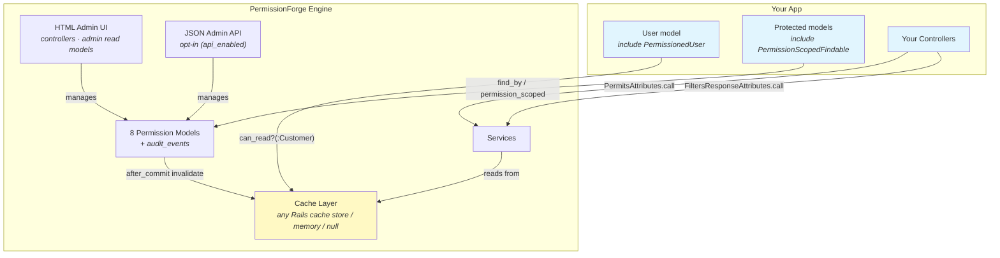
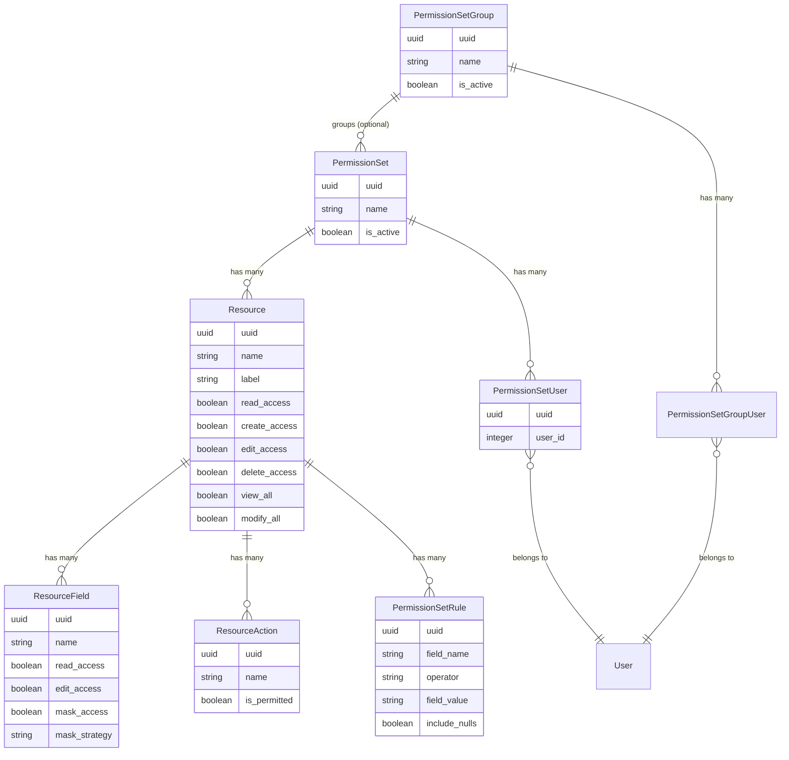
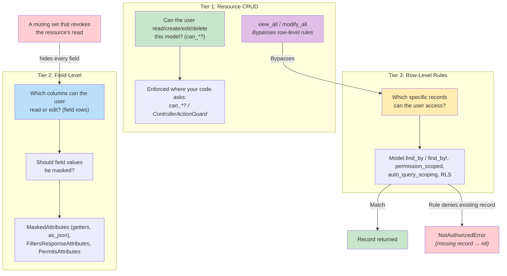
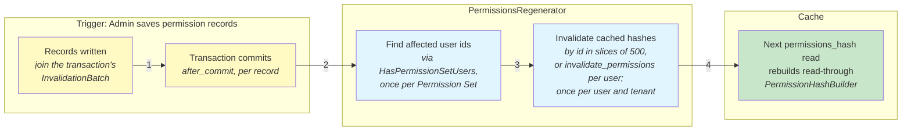
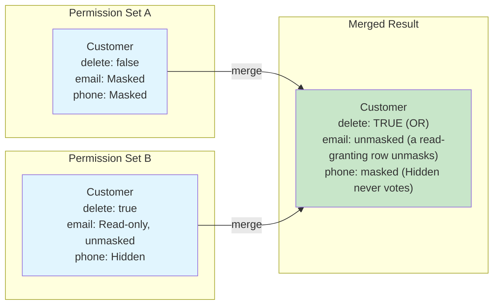
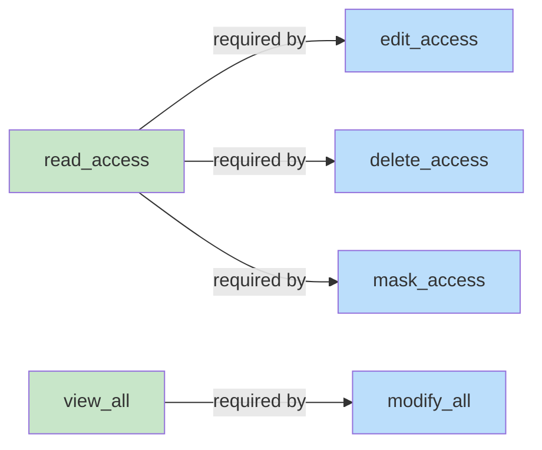
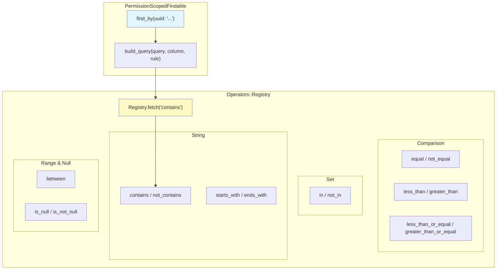
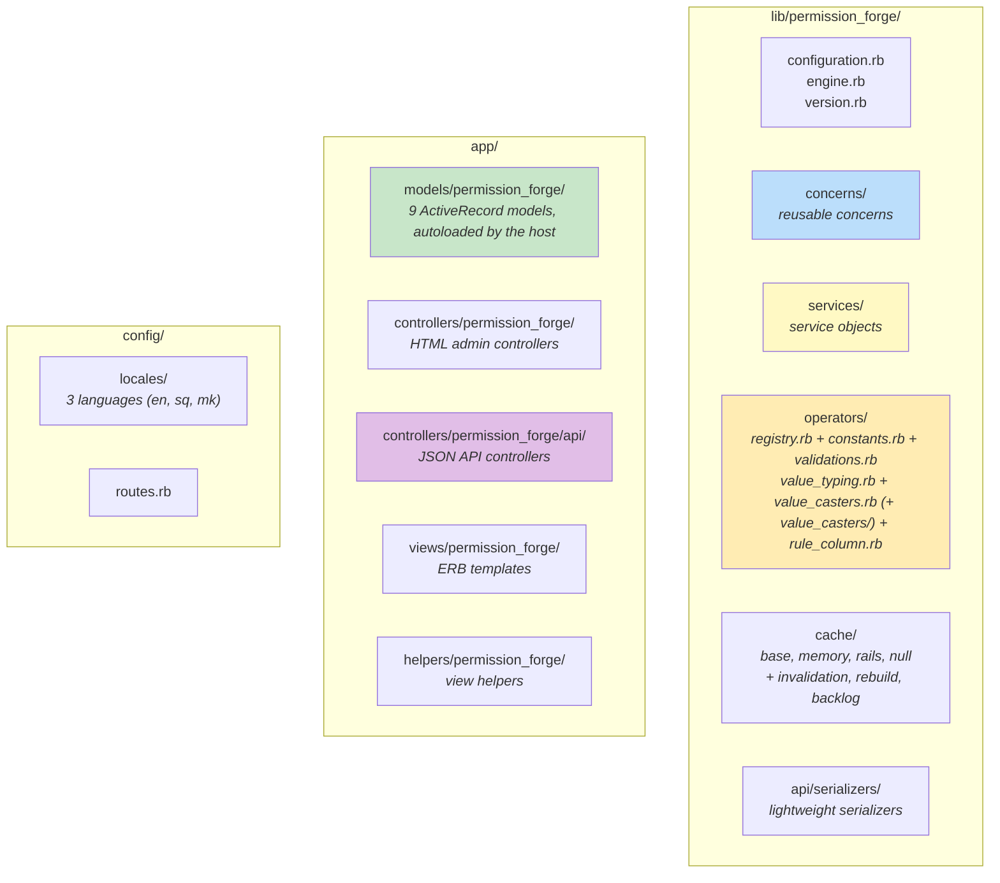
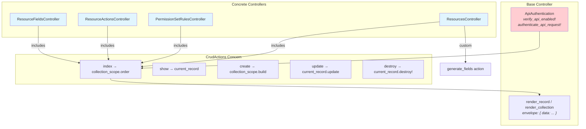

# Architecture

## How It All Fits Together



## Data Model

How permission records relate to each other:



## The 3-Tier Permission System

Permissions are described in 3 layers. Each layer is enforced in its own places; a layer does not switch on the next one:



- **Resource CRUD flags guard nothing by themselves.** `read_access: false` on a resource does not stop `find_by` from returning a record or a getter from returning a value. The flags are enforced where the host calls `can_read?` / `can_create?` / `can_edit?` / `can_delete?` (or `can?`), or uses `ControllerActionGuard`.
- **Field rows decide field access** for granting sets. A **muting** set that revokes the resource's read hides every field of the resource (see [Muting Permission Sets](muting-permission-sets.md)).
- **Row-level rules** apply where the model includes `PermissionScopedFindable`: the class-level `find_by` / `find_by!`, `permission_scoped`, the automatic scope when `auto_query_scoping` is on, and PostgreSQL RLS when it is installed. A user with no rules for a model gets every row.

## Request Lifecycle

What happens when your app handles a request:

```mermaid
sequenceDiagram
    participant Client
    participant Controller
    participant PermitsAttributes
    participant Model
    participant PermissionScopedFindable
    participant FiltersResponse
    participant Cache

    Note over Client, Cache: WRITE PATH (create/update)
    Client->>Controller: POST /customers { name: "Acme", email: "..." }
    Controller->>PermitsAttributes: filter params by edit_access
    PermitsAttributes->>Cache: read field permissions
    Cache-->>PermitsAttributes: { name: { edit_access: true }, email: { edit_access: false } }
    PermitsAttributes-->>Controller: { name: "Acme" } (email removed)
    Controller->>Model: Customer.create!(filtered_params)

    Note over Client, Cache: READ PATH (show/index)
    Client->>Controller: GET /customers/:uuid
    Controller->>Model: Customer.find_by(uuid: "...")
    Model->>PermissionScopedFindable: intercepts find_by
    PermissionScopedFindable->>Cache: read rules for Customer
    Cache-->>PermissionScopedFindable: [{ operator: "equal", field: "owner_id", value: "current_user" }]
    PermissionScopedFindable-->>Model: applies WHERE owner_id = 42
    Model-->>Controller: customer record (nil if missing; NotAuthorizedError if a rule denies it)
    Controller->>FiltersResponse: filter attributes by read_access
    FiltersResponse->>Cache: read field permissions
    FiltersResponse-->>Controller: { name: "Acme", email: "j***@example.com" } (masked)
    Controller-->>Client: 200 OK { data: { ... } }
```

## Cache Invalidation Flow

When permission data changes, affected users' caches are invalidated; each user's hash is rebuilt lazily (read-through) on their next permission read:



Assignment changes take effect immediately too: `PermissionSetUser` invalidates its own user on create/update/destroy (so `PermissionSet#destroy` invalidates every previously-assigned user through the `dependent: :destroy` cascade). An assignment moved to another user invalidates the previous holder as well.

**Holders are invalidated by id.** The affected user ids are plucked per Permission Set (no user is loaded) and invalidated in slices of 500 (`Cache::HolderInvalidation`, through `Cache::BulkInvalidation`): per slice, one multi-key write of fresh stamps, then one multi-key removal of the keys (nothing is read; per-context variants are left to their TTL, see [Keys, base entries and per-context variants](#keys-base-entries-and-per-context-variants)) — every stamp of a slice is written before any key is removed. The keys are the ones `User#invalidate_permissions` removes (`Cache::UserKeys`). The holders are loaded and invalidated one by one through `User#invalidate_permissions` instead in three cases:

- the user model (or a loaded subclass of it) overrides `invalidate_permissions`, `permission_cache_key` or the private `pf_invalidation_stamp_key` — the host's code has to run;
- something listens for, or stores, the `permissions.invalidated` event — each event carries its user;
- the invalidation runs while a transaction that reads from a snapshot is still open around it (a record saved in a non-joinable transaction nested in another one; see "Inside a transaction") — each invalidation is then settled after the outer commit by the user's own instance.

**Which concern finds affected users (HasPermissionSetUsers):**

| Model | Strategy | How it finds users |
|-------|----------|-------------------|
| `PermissionSet` | `:self` | Direct — its own `permission_set_users` |
| `Resource` | `:direct` | Via `permission_set_id` foreign key |
| `PermissionSetRule` | `:direct` | Via `permission_set_id` foreign key |
| `ResourceField` | `:via_resource` | Via `resource_id` -> Resource -> PermissionSet |
| `ResourceAction` | `:via_resource` | Via `resource_id` -> Resource -> PermissionSet |

A record moved to another Permission Set (or a field or action moved to another resource) affects the users of both: every value the foreign key had since the record's last commit is noted at each save and followed by the lookup — also after a savepoint rollback, and also when another instance of the same row commits (the note is left in the batch).

**The lookups follow the record's tenant, not the ambient one.** A record of tenant A saved or destroyed while tenant B is ambient — or none, as in a job or the console — still finds every assignment of its Permission Set in tenant A, together with assignments that have no tenant (rows older than tenancy). It does not match another tenant's assignment that merely carries the same id. A record without a tenant looks in every tenant. Where users are loaded (the per-user path), they are loaded past the default scopes of the host's user model, so an ambient tenant or a soft-delete scope there does not hide the holder of an assignment. (Nothing goes through `ActsAsTenant.with_tenant`, which writes the tenant it resolved back into the request-level one.)

### One invalidation per user per transaction

A "Review and save" that writes 20 records in a Permission Set assigned to 50 people commits once, so it invalidates 50 hashes — not 20 × 50. Every record still runs its own invalidation in its own `after_commit`; what the records of one commit share is an `InvalidationBatch` that remembers what has already been done **after that commit**:

- which users were invalidated (once per user and tenant, by id or through `User#invalidate_permissions`),
- the affected-user lookups (one per Permission Set: the holders' ids),
- that the managed-actions index was dropped (`InvalidatesManagedActions`, once per tenant).

The batch never holds work that only it knows about, so losing or mistrusting one only costs repeated invalidations. The rules that keep a record from skipping an invalidation it still owes (`Concerns::InvalidatesInBatch`, `InvalidationBatch`):

| Rule | Why |
|------|-----|
| A record joins the batch still open on its thread and connection in `before_save` / `before_destroy` | A before callback has run whenever the row is written. An open batch has been used by no commit, so it remembers nothing |
| The first `after_commit` claims the batch; nothing joins it afterwards | Records written later (the next transaction, or a write made by an `after_commit` callback) get a new batch |
| A record reuses a batch only from where it was claimed: same connection, same transaction depth, same ambient tenant | A transaction nested in a non-joinable one runs its commit callbacks while the outer transaction is still open, at a deeper transaction depth. What it invalidated says nothing about the outer commit |
| `after_commit` takes the record's reference: it is used once | A record saved in two successive transactions invalidates after each |
| `touch` drops the reference | It has no before callback, so a touched record invalidates on its own |
| A user is remembered only once its invalidation (per user, or the bulk call) has returned | An invalidation that raised was not done |
| The batch forgets what it remembers as soon as another permission record is written (or touched) anywhere in the process | Other callbacks run between two `after_commit`s of one commit. One of them may write a record — also from another fiber or thread — whose own invalidation comes too early to count: in a transaction nested in a non-joinable one it runs at the savepoint release, before the COMMIT. The records still waiting then invalidate again, after that write |
| Outside `after_commit` there is no batch | Calling `invalidate_permissions_for_users` by hand always invalidates |
| Nothing is raised out of `after_commit` | Rails would skip the commit callbacks of the remaining records. A user whose invalidation fails is reported (see "When the cache store fails") and the others still get theirs |

A rollback (of the transaction or of a savepoint) leaves the batch open and unused; the records that do commit later join it and invalidate as usual. Coalescing is per transaction: records saved one by one, each in its own implicit transaction, still invalidate one by one.

**The managed-actions index** (`InvalidatesManagedActions`) is dropped in the same `after_commit`, before the users are invalidated, and each of the two runs even when the other raises. A record notes at save time that it changed what is managed, and the note is only ever consumed by a commit: a rollback does not clear it (a later save rolled back to a savepoint would otherwise take the note of an earlier, committed save with it), so after a rollback the record's next commit drops the index once more than needed. The note is also left in the batch, because of two instances of one row written in a transaction Rails runs the commit callbacks of only one — which finds in the batch what the other noted.

### A rebuild that races an invalidation

A read-through rebuild reads the permission rows — in a fixed number of queries, 7 (8 when an assignment names who granted it), whatever the number of sets and resources — and then stores the hash. If a commit and its invalidation land in between, the rebuild would store a pre-commit hash after the key was deleted, and nothing would remove it before `cache_ttl`. With one invalidation per user per commit there is no second invalidation to repair it by accident, so the rebuild checks for itself (`Cache::Invalidation`, `Cache::Rebuild`):

| Step | What happens |
|------|--------------|
| `invalidate_permissions` (and the bulk path) | Writes a fresh per-user stamp (`user_<id>_invalidation`, kept for `cache_ttl`), **then** removes the keys — also when the stamp could not be written. One stamp per user, whatever the tenant. The bulk path writes all the stamps of a slice before it removes any key |
| `regenerate_permissions` | Reads the stamp, reads the rows, stores the hash, reads the stamp again. The entry is kept only when both reads return the same stamp |
| There is no stamp | The rebuild writes one first and reads it back. A missing stamp and a stamp that could not be read look the same, so nothing is concluded from two empty reads |
| The stamp changed | The hash may be from before the commit: the entry is removed at once (the repeat may take long, or raise), then the hash is built and stored once more |
| The stamp changed again | The entry is removed again, so the next read rebuilds |
| The attempt raises | The entry is removed: a hash that could not be checked is not kept |

Stamp first, then remove: a pre-commit hash only survives when it is stored after the removal, and the rebuild re-reads the stamp after storing — so the new stamp must already be there. (Removing first would leave a gap in which the hash is stored and the old stamp is still seen.)

Whatever becomes of the entry, **the request that asked gets the hash that was built for it** — never an empty one. An empty hash denies every `can_*?` check but also has no record rules, which would switch row-level rules off. It is the hash the request built (and, when the entry was kept, verified), memoized on the user instance; the entry is not read back, because another rebuild that raced an invalidation has its own hash in the store for the instant between its write and its check.

**What a user object keeps is the memo** (`PermissionsMemo::Memo`): the hash, the cache key and the `PermissionForge.permissions_cache_version` it was memoized under, the transaction it was built in when it was withheld, when the soonest assignment that went into it ends (it is retired then), and — for a user who holds conditional sets — what selected the hash (the passing conditional sets and the request context), as one frozen object. For such a user every read checks the memo against the current request context: a read in another context (another IP, other session flags, another hour) selects again, so one instance never serves one session's conditional grant to another. Every invalidation or rebuild in the process bumps the version, which retires every memo of the process. Two consequences for an object that lives longer than a request:

- **The version is per process.** A user object kept across requests (in a cache, a class variable, a long-running job) learns only of the invalidations made in its own process; one made in another process reaches the store, not that object, until its memo is dropped — by `reload`, or by any invalidation or rebuild in its process. Load the user per request.
- **An invalidation that lands after a rebuild's stamp check** — between the check and the moment the rebuilding object memoizes its hash — removes the entry from the store and bumps the version, but the rebuilding object memoizes its hash under the version after that bump. That object first sees the invalidation at the next invalidation or rebuild in the process; the store and every other object see it at once.

One object read on several threads at once is safe in the ways that matter: each thread gets the hash it built or read whole (never another thread's key with this one's hash, never `{}`), the `{}` a build is answered when it asks for its own user is for that call only, and a hash built inside a withheld transaction is served only on that transaction's connection and is not replaced from another connection while the transaction is open.

Inside a request two caches would answer the rebuild with what it already saw, so it goes past both:

- **ActiveRecord's query cache.** Everything a rebuild reads (the user's sets, the permission rows, the assignment expiry, the profile) is read with the query cache off. Otherwise the repeated build — or a second rebuild later in the same request — would get the rows of the first.
- **The cache store's local copy.** Redis, Memcached and Solid Cache stores remember every read of a request, a miss too. The stamp is read from the store itself (`Cache::Base#read_fresh`); otherwise the second read would return the first.

**A host app that derives its own cache entry** in an override of `regenerate_permissions` (after `super`) has the same race on its own write. It can use the same stamp:

```ruby
def regenerate_permissions
  stamp = permission_invalidation_stamp
  super
  Rails.cache.write(my_key, derive_from(permissions_hash))
  Rails.cache.delete(my_key) unless permission_invalidation_stamp == stamp
end
```

### Inside a transaction

Whether a transaction changes anything depends on what it reads. A transaction that reads **committed rows** (PostgreSQL at its default, READ COMMITTED) sees what a request outside a transaction sees, plus its own changes — a rebuild inside it is as good as one outside, and nothing is different there. A transaction that reads from a **snapshot** (REPEATABLE READ or SERIALIZABLE — MySQL's default, and what SQLite gives) keeps seeing the rows as they were when it began: when that is before an invalidation that has already finished, a rebuild reads pre-commit rows however often it repeats, and the stamp check passes on a stale hash.

`config.snapshot_transactions` says which it is:

| Value | A transaction is treated as reading from a snapshot |
|---|---|
| `:auto` (default) | On MySQL (`Mysql2`, `Trilogy`) and SQLite: always. On PostgreSQL (`PostgreSQL`, `PostGIS`): only when a transaction on the stack was opened with `isolation: :repeatable_read` or `:serializable`. On any other adapter: always. Decided from the adapter's name and the isolation level Rails was given — the server is not asked |
| `true` | Always. For a PostgreSQL whose default isolation was raised for the database, the role or the session (`default_transaction_isolation`), which Rails does not know |
| `false` | Never. For a MySQL run at READ COMMITTED |

**Where a transaction is not a snapshot, nothing changes inside it.** A rebuild is stored, `regenerate_permissions` stores at once, `invalidate_permissions` invalidates at once and is not repeated, and the hash an instance holds is not tied to the transaction — the same store calls and the same answers as outside a transaction. Two things follow, as they always did:

- A hash stored from inside a transaction that then **rolls back** stays in the cache: `transaction { grant; user.regenerate_permissions; raise ActiveRecord::Rollback }` leaves the grant cached until `cache_ttl`. Call `user.invalidate_permissions` after the rollback — or regenerate after the commit instead of inside the transaction.
- `user.invalidate_permissions` inside a transaction removes the entry before the change is visible to anybody else, and a request that rebuilds in between caches the rows as they still are. Invalidate after the commit.

**Where it is a snapshot, the cache is left alone.** A hash built there is not stored, and nothing else is written to or removed from the store either. The request uses what it built: the user instance keeps it, and **does not read the store again until that transaction has ended** — the entry there holds the rows as they were before the transaction. So a hash that is retired meanwhile (any rebuild or invalidation in the process retires every instance's hash), dropped by `reload`, or void because the savepoint it was built in was rolled back, is built again from the transaction's rows; a savepoint that is released leaves it in place. Once the outermost transaction has ended, the instance reads the store like any other and caches as usual.

**What counts as open** (`PermissionForge::OpenTransaction`): a joinable transaction is on the connection's stack.

| On the connection | Open? |
|---|---|
| No transaction | No |
| `transaction { }`, `record.with_lock { }`, a save's own transaction (`after_save`, `before_commit`) | Yes |
| A savepoint: `transaction { transaction(requires_new: true) { } }` | Yes |
| A non-joinable transaction inside another: `transaction { transaction(requires_new: true, joinable: false) { } }` | Yes |
| The transaction Rails wraps a test in (not joinable), also with a second one around it (test-prof's `before_all` / `let_it_be`, DatabaseCleaner's transaction strategy) | No — a test suite caches as before |
| A transaction opened inside a test | Yes |
| `transaction(joinable: false) { }` with nothing joinable around it | No — it looks exactly like the one of a test (known limit, below) |
| `rails console --sandbox` (one non-joinable transaction) | Yes, and it is treated as a snapshot whatever the setting says: nothing done in a sandbox is committed, so nothing is stored from it |
| `after_commit`, `after_rollback` of a real transaction | No — it has ended |

**Asking for a rebuild inside a snapshot transaction settles at the commit** (`Cache::Settlement`). `regenerate_permissions` says that something changed — it is how to refresh after `update_all`, `insert_all` or `delete_all`, which run no callbacks. Inside such a transaction it can leave nothing in the cache, and by itself that would tell nobody: another request can cache the rows as they still are before the commit, and keep them until `cache_ttl`. So the user is invalidated once the **outermost** transaction has committed, with an ordinary `invalidate_permissions` (a new stamp, then the removal, which also catches a rebuild that straddles the commit):

```ruby
ActiveRecord::Base.transaction do
  PermissionForge::PermissionSetUser.where(permission_set: set).delete_all # no callbacks
  user.regenerate_permissions   # builds for this request; the store is not touched
end                             # COMMIT, then: user.invalidate_permissions
```

- Once per user for each transaction that asked, however often and on whichever instance (a savepoint counts on its own, so asking in a savepoint and again outside it invalidates twice).
- Nothing after a rollback — of that transaction, or of one around it.
- For the tenant that was ambient when it was asked; the commit may run after the block that made it ambient.
- `invalidate_permissions` inside such a transaction invalidates at once, as it always did, **and** once more after the commit. That also covers the invalidations the gem makes itself when a record is saved inside a non-joinable transaction nested in an ordinary one: Rails runs those commit callbacks at the savepoint release, before the COMMIT.
- A read-through rebuild (a cache miss) changed nothing: it arranges nothing, and it retires nobody else's hash.
- Until the commit only the instance that asked works with the transaction's rows. Another instance of the same user reads the entry of the committed rows, as it does after any change that is not committed yet. Where every instance has to see the change at once, call `invalidate_permissions`: it removes the entry now (and again after the commit), and each instance then builds for itself.

**How it is done, on every Rails version (7.1 to 8.1) alike:** everything is asked of the adapter's own transaction objects — the stack of the connection's transaction manager, each transaction's `joinable?`, `state` and `isolation_level` — and the settlement is enlisted in the transaction the way Rails enlists a record that has commit callbacks (`add_record`). Rails finishes every enlisted record when the transaction commits: also when an `after_commit` callback of another record raises, and before the blocks registered through `ActiveRecord::Transaction#after_commit` (Rails 7.2+) — which is why that public API is not used: Rails skips such a block as soon as any commit callback of the transaction raises, and it neither sees a transaction that is not joinable nor says how one ended.

**A host app that writes a cache entry of its own** from an override of `regenerate_permissions` has to make the same decision for that entry: `PermissionForge::OpenTransaction.withholding` answers the open transaction when the hash just built must not be shared (nil otherwise).

```ruby
def regenerate_permissions
  super
  Rails.cache.write(my_key, derive_from(permissions_hash)) unless PermissionForge::OpenTransaction.withholding
end
```

**What a snapshot database pays** (MySQL, SQLite; measured on 50 `update!` calls on loaded records of a model with `MaskedAttributes`, each save being its own transaction):

| | Hashes built | Queries for them | Cached afterwards |
|---|---|---|---|
| Warm entry (the usual case) | 0 | 0 | yes |
| Cold entry, permissions first read inside each save | 50 — one per transaction | 350 | no |
| Cold entry, `current_user.permissions_hash` read once before the loop | 1, before the loop | 7 | yes |
| Cold entry, the 50 saves inside one transaction | 1 | 7 | no (stored by the next read outside) |
| The same on a database that reads committed rows, or with the option `false` | 1 | 7 | yes |

So on a snapshot database: read the permissions once before a loop of saves (or before the transaction opens) — an authorisation check at the start of a request does that anyway. A job or console session that never reads permissions outside a transaction builds them once per transaction; after 20 such rebuilds in a row this is logged, once per process. A MySQL that runs at READ COMMITTED can set the option to `false`.

### When the cache store fails

Redis, Memcached and Solid Cache stores do not raise when they are unreachable: a write answers false or nil, a delete answers false — which it also answers when there was nothing to delete. So the answers are checked:

| | |
|---|---|
| A write | Counts as written only when the store says so |
| A removal (`Cache::Base#expunge`) | A delete that answers true removed the entry. One that answers false is followed by overwriting the key with an empty entry that expires at once: a write says plainly whether it worked, and a read of that entry is a miss |
| An invalidation the store did not confirm | Tried again, three times in all (stamp and keys each time). A bulk invalidation repeats only the users the store did not confirm |
| It still fails | Nothing is raised. The failure is logged at error level, published as the `cache_failure.permission_forge` notification, and handed to `config.on_cache_failure` (a subscriber or a hook that raises is logged and stops neither the other nor the commit). The invalidation is still **owed** (below). A bulk invalidation reports and owes each failed user on its own |
| The store keeps failing | For five seconds after a failed invalidation the next ones make a single attempt, so a commit that invalidates many users does not wait three times as long for nothing |
| A store that raises (one without a failsafe) | During a rebuild, a write or stamp read that raises counts as answering false: the hash is built and used, not kept. A plain read that raises makes `permissions_hash` raise. A multi-key call that raises confirms nothing |
| A rebuild wrote a hash it could then neither verify nor remove | Reported the same way (`operation: :discard`) and owed — also when the store said the write had failed, because it may have been applied all the same. Reported once while it is owed, not on every rebuild that fails the same way |
| The managed-actions index | Invalidated by the same code (`Cache::Invalidation`, one stamp `managed_actions_invalidation` for every tenant's index): stamped, every key removed also when the removal of one raises, tried again, reported with its keys (`user_id: nil`) and owed when the store does not confirm. While it is owed this process builds the index from the database instead of reading it. Other processes may serve the old index until it expires: 60 seconds at most |

A store that is down never widens access: a read that fails is a miss, the rebuild cannot keep a stamp and so stores nothing, and the request works with the hash it built.

**Owed invalidations** (`Cache::Backlog`). An entry that could not be removed while the store was unreachable is a cache hit again the moment the store is back, and would stay one until `cache_ttl`. So each process keeps a list of the users — and the managed-actions index — whose invalidation failed for good, listed by stamp key:

- A user on the list is not read from the store by that process — the hash is rebuilt, and the rebuild replaces the entry as soon as the store takes writes again.
- The listed invalidations are made (one attempt each: a new stamp, then the removals) right after the next invalidation the store confirms, and before the next hash is read from the store while the list is not empty.
- Not inside the five seconds after a failed invalidation, and not from inside an open transaction. One pass tries 25 entries at most — the next confirmed invalidation or store read goes on with the rest — so a recovery does not land on one request (500 owed users would otherwise cost one request about 2,500 store calls). A pass stops after three failed attempts and the next one waits five seconds, so an outage adds at most three failing calls to one request every five seconds, not one to every request. An attempt that failed moves to the end of the list, so a user whose key keeps failing does not hold up the others.

This is extra effort on top of the report, **not a guarantee**: the list lives in the process (another process serves the entry as before, and a restart forgets the list), it holds 500 entries, users and the index together (the one owed longest makes room), and it is dropped when the cache store is replaced. An outage during an edit to a set with more than 500 holders therefore owes only the last 500; the others rely on `cache_ttl` (each was reported). For all of those the entry's own expiry remains the backstop — `cache_ttl` for a user's permissions, 60 seconds for the managed-actions index — and every failure was reported when it happened.

What the callers answer. `invalidate_permissions` returns whether the store confirmed it — but host apps override that method, and what an override returns is its own business (a real one ends in the removal of an entry of its own, so its value is whether that entry existed). Code that has to say what happened therefore asks the gem's own bookkeeping, `Cache::Failure.none? { user.invalidate_permissions }`: whether the block got through without a failure being reported on its thread. The services answer from it — `DataSubjectErasure` (`cache_cleared`), `ConsentWithdrawalHandler` (`invalidated`), and the `invalidated` count of `BulkPermissionSetAssignment` and `ExpiredAssignmentCleaner`, which counts confirmed invalidations — and so do the admin's People screens: "refresh cached permissions", "erase", "withdraw consent" and "remove all" show an error instead of a confirmation. The database change is made in every case. `DataSubjectErasure` called inside a database transaction answers `cache_cleared: nil`: the assignments are only gone for everybody else, and the cached permissions with them, when that transaction commits, and a failure then is reported through `config.on_cache_failure` alone.

What it costs, in calls to the store:

| | Calls |
|---|---|
| Cache hit | 1 read (0 while the instance's memo serves); for a user with conditional sets, 2 when a conditional set passes (the base entry and the variant), 1 when none does |
| Rebuild | 3 reads, 1 write (the first one after the stamp expired: 4 reads, 2 writes) |
| Rebuild inside a snapshot transaction | 1 read (the miss), nothing else; none at all once the instance has built there |
| `regenerate_permissions` inside a snapshot transaction | None until the commit, then one invalidation |
| The same inside a transaction that is not a snapshot | As outside a transaction |
| Invalidation | 1 write for the stamp, 1 delete per key — this version's two or three keys and the same keys of the 0.13 namespace — and 1 more write for each key that was not in the cache. Nothing is read; per-context variants are not removed |
| Edit to a set with N holders, by id, on Redis or Solid Cache | 2 calls per 500 holders (one multi-key write of the stamps, one of the keys) |
| Erasure (`DataSubjectErasure`) | The invalidation above, then 1 stamp write and the removal of the index entry and the 63 slots of each of the person's base keys in one multi-key call (nothing read) |
| `cache:clear` by enumeration (no key patterns) | Per 500 users: the invalidation above, 1 multi-key read of the index entries, and for the users who have one, 1 stamp write and the removal of the index entry and 63 slots per base key |
| The same on Memcached, file or memory stores | One call per key, about 3–5 per holder (these stores have no multi-key write the gem can use) |
| Invalidation while the store is down | Three attempts of 1 write and 1 delete per key; after that 1 attempt for five seconds |
| Edit to a set with N holders while Redis is down | About 2 × (3 + ⌈N/500⌉ − 1) failing calls in the saving request: three attempts for the first slice, one for each slice after it. With `RedisCacheStore`'s default timeouts that was measured at 16 s for 1,000 holders and is about 90 s for 10,000. Lower the store's `connect_timeout` / `read_timeout` if that matters |
| Rebuild while the store is down | 2 reads, 1 write, nothing stored (for a user who is owed an invalidation: 1 read, 1 write) |
| Owed invalidations while the store is down | At most 3 writes every five seconds per process |

**Known limits:**

- A store that reports success and still loses the write or the delete cannot be noticed.
- An invalidation that failed while the store was unreachable is made up for only by the process that owes it (see above). Another process serves the old hash from the store once it is back, until that process has made the invalidation or `cache_ttl` has passed.
- Between a racing rebuild's write and its check — two store calls — its pre-commit hash is in the store. A request that reads the key in that instant works with it for that one request; it is not kept.
- Writes that skip callbacks (`update_all`, `update_columns`, `insert_all`, `delete`) invalidate nothing — call `user.invalidate_permissions` (or `regenerate_permissions`) afterwards. Inside a snapshot transaction either one is settled after the commit; inside any other, call it after the commit.
- **Where transactions read committed rows** (PostgreSQL at READ COMMITTED, or `snapshot_transactions = false`) a transaction is not special, with what that has always meant: a hash stored from inside a transaction that then rolls back stays cached (`transaction { grant; regenerate_permissions; ROLLBACK }` — call `invalidate_permissions` after the rollback, or regenerate after the commit); and an invalidation made inside a transaction — also the gem's own, for a record saved inside a non-joinable transaction nested in an ordinary one — comes before the COMMIT and is not repeated after it.
- `:auto` only knows what Rails was told. An isolation level set for the database, the role or the session (`default_transaction_isolation`, `SET SESSION CHARACTERISTICS`), or by SQL the app sends itself, is not seen: set the option to `true`. A MySQL that runs at READ COMMITTED is taken for a snapshot database: set it to `false` to stop paying for it.
- A transaction opened with `joinable: false` **and nothing joinable around it** is not recognised as open: it is indistinguishable from the transaction Rails wraps a test in. A hash built inside it is stored, and Rails runs the commit callbacks of what is saved inside it at the savepoint release, before the COMMIT — the invalidation comes before other connections can see the rows, and is not repeated. `rails console --sandbox` is such a transaction and is recognised (`Rails.application.sandbox?`): nothing is stored from a sandbox, so a grant tried out there does not outlive its rollback. A console that wraps its work in a non-joinable transaction by hand is not.
- **A host's own cache entry** derived from the permissions — written from an override of `regenerate_permissions`, say — is the host's to guard: the gem withholds its own entry inside a snapshot transaction, not the host's. Ask `PermissionForge::OpenTransaction.withholding` before writing it (see "Inside a transaction"), and remove it in the `invalidate_permissions` override.
- **Solid Cache in the application's own database, on the application's connection:** every store call made inside a transaction is part of it. An `invalidate_permissions` inside a transaction writes the stamp and the placeholder rows there and holds them until the commit, so another request that invalidates or rebuilds that user waits for it (and a rollback takes the invalidation back); where transactions are not snapshots, a rebuild inside a transaction holds the entry it stores the same way. Give Solid Cache its own database or connection, or invalidate after the commit.
- Two instances of one row, where the one that changed what is managed (or moved the row to another Permission Set, resource or user) is not the one whose commit callbacks run: the note in the batch covers it, unless a transaction nested in a non-joinable one claimed the batch first. The managed-actions index then stays as it was for up to 60 seconds, and the previous set's holders keep their cached hash until `cache_ttl`.
- **The managed-actions index** is never written to the store from inside an open transaction (whatever `snapshot_transactions` says: uncommitted rows are visible to their own transaction at every isolation level), and a drop made inside one is repeated after the outermost commit. A build outside a transaction is checked against the index's invalidation stamp like a permission hash (`Cache::Rebuild`): one that raced a commit is not left in the store. A drop the store does not confirm is tried again, reported and owed; other processes may serve the old index for 60 seconds at most.
- Where the ids of the host's users are only unique per tenant, an invalidation reaches every user with that id; the cache keys are built from the id alone.
- A permission table that has no tenant column (an install that predates it) is looked up without one: a change reaches the holders of the Permission Set whatever tenant the assignment was meant for.

**The cache backend interface** (`Cache::Base`) has, besides `read`, `read_fresh`, `write`, `delete`, `expunge` and `clear`, three multi-key methods the bulk path uses: `write_many(entries, ttl:)`, `expunge_many(keys)` and `delete_many(keys)`. The defaults loop over `write` / `expunge` / `delete` and try every key. `write_many` and `expunge_many` answer `{ key => true/false }`; `delete_many` removes without confirming (for users whose stamp was already refused). A key whose call raises counts as false, and the error is yielded to the block. `RailsCache` uses the store's own `write_multi` where the store has one (Redis pipelines it, Solid Cache writes one statement). Its answer counts for every key of the batch, and only when the store handed no error to its `error_handler` during the call (`Cache::HandledErrors` wraps a store's handler the first time it writes a batch to it, and calls the store's own handler unchanged): Rails 8.2's Redis store answers `write_multi` the same way whether Redis took the entries or not. A wrapper that delegates to `PermissionForge.cache` must forward the block of these methods: it carries the error into the failure report.

## Multi-Set Merge Logic

When a user belongs to multiple permission sets, permissions are merged:



**Merge rules:**
- **CRUD / Field read and edit / Actions**: OR logic — `true` wins (any set granting = access granted)
- **mask_access**: decided only by the field rows that grant read — AND logic among them, so `false` wins (any read-granting set that unmasks = user sees full value), with the first such row's `mask_strategy`. A row that does not grant read (Hidden) never votes: Masked in one set and Hidden in another is masked.
- **Rules**: accumulative and **intersecting** — the rules of every granting set apply together (AND), so adding a set with a rule can narrow the rows another set allowed. `view_all` / `modify_all` from any granting set bypasses them all on that resource.
- **Extra (virtual) fields**: once every granting set is merged, a declared virtual field that no set has a row for gets an implicit entry that follows the merged resource: readable when it grants read, editable when it grants edit, unmasked (unless `extra_fields_default_access = :unconfigured`). A row in any set wins.
- **Muting sets** (`is_muting: true`): applied after the granting merge — they revoke CRUD/field/action access, force `mask_access: true`, and also mute configured field variants (`_uuid`, `_cents` base name) — the variants the model has (`FieldVariants`), the ones the granting merge wrote. A muting resource with `read_access: true` hides every field of the resource (read and edit), variants and implicit virtual fields included; muting its edit mutes the flag alone. They never add rules.

**Order.** Sets are merged in `created_at`, `id` order; within a set, resources and their fields, actions and rules in id order. Order only decides ties: the first read-granting row of a name sets `mask_strategy`, and rules and actions keep it in the hash. A known limit follows from it: when two rows map to one name — `customer_id` (whose variant is `customer_uuid`, on a model that has a `customer_uuid`) and an explicit `customer_uuid` row — the older row wins the strategy, so a later explicit `customer_uuid` row cannot override the strategy that the `customer_id` variant brought.

## Dependency Validations

Some permission flags depend on others. These are enforced by the `ValidatesDependency` concern:



You cannot enable `edit_access` without `read_access`, `delete_access` without `read_access`, `modify_all` without `view_all`, or `mask_access` without `read_access`.

## Operator Registry (Strategy Pattern)

Row-level rules use 15 operators, organized via the Strategy Pattern:



Each operator is a callable object (`method(:op_equal)`) stored in a frozen Hash. Adding a new operator = adding 1 method + 1 hash entry. Zero changes to `PermissionScopedFindable`.

Before a built-in strategy runs, `Operators::ValueTyping` gives the rule's value the type of the column it is compared with (`Operators::RuleColumn` finds the column, `Operators::ValueCasters` holds one caster per column type). A value the column cannot hold never reaches a strategy: the rule matches nothing. `Services::RlsOperatorSql` compiles RLS policies through the same typing, so a policy selects the rows the application layer selects. See [How Values Are Compared](row-level-rules.md#how-values-are-compared).

## Directory Layout



## API Architecture

The JSON API uses a Template Method pattern via the `CrudActions` concern:



Each concrete controller only defines 4 template methods: `collection_scope`, `current_record`, `serializer_type`, `record_params`.

## Cache Structure

When `user.regenerate_permissions` is called — or `user.permissions_hash` misses the cache and rebuilds read-through — the following hash is computed and cached:

```ruby
{
  profile: { id: 1, uuid: "...", name: "Alice", email: "alice@example.com" },
  preferences: {},
  permissions: {
    resources: {
      Customer: {
        permissions: { read_access: true, create_access: true, edit_access: false, delete_access: false, view_all: false, modify_all: false },
        fields: {
          name:  { read_access: true, edit_access: true, mask_access: false, mask_strategy: 'full' },
          email: { read_access: true, edit_access: false, mask_access: true, mask_strategy: 'email' }
        },
        actions: {
          sync:   { is_permitted: true },
          export: { is_permitted: false }
        },
        source_permission_sets: [{ uuid: "...", name: "Sales Team", ... }],
        permission_set_rules: [{ field_name: "owner_id", operator: "equal", field_value: "current_user", ... }]
      }
    }
  }
}
```

### Keys, base entries and per-context variants

`Cache::UserKeys` is the one definition of a user's keys, for `User#invalidate_permissions` and for the bulk invalidation of a set's holders alike:

| Key (after `cache_key_prefix`) | Holds |
|---|---|
| `v2:user_<id>` / `v2:tenant_<t>_user_<id>` | The **base entry**: the hash above built from the user's unconditional Permission Sets. For a user who holds conditional sets it also has `conditional_sets: { token:, sets: [{ id:, muting:, requires_session_flag:, allowed_ips:, allowed_hours_start:, allowed_hours_end: }] }`; for a user with an assignment that ends, `assignments_expire_at` (epoch seconds of the soonest `expires_at`). Neither is ever part of `permissions_hash` |
| `v2:…_user_<id>_c_index` | The **index entry**: `true` — variants may be stored under this base key. Written after the variant's rebuild read the user's stamp and before the variant is stored; lives `cache_ttl` + 60 s, longer than any variant written after it. Read only by the enumerated `cache:clear` (`Cache::VariantRemoval`). A variant whose index entry cannot be written is not stored |
| `v2:…_user_<id>_c_<1..63>` | A **variant**, in the slot of its sets (the bitmask of the passing sets among the user's conditional sets, sorted by id): the hash for that combination, plus `variant_of` (digest of the base's token and the set ids), checked on every read. Built read-through, verified against the user's stamp |
| `user_<id>_invalidation` | The per-user invalidation stamp (one per user, whatever the tenant and version) |
| `user_<id>`, `tenant_<t>_user_<id>` | 0.13's keys, removed by every invalidation until 0.15 |

Every read of a user who holds conditional sets evaluates the request context against the conditions in the base entry (`ConditionalSets`, `PermissionsPerContext`) and serves the base when no conditional set passes, else the variant. `permissions_hash` always returns the three public keys. A user who holds more than 6 conditional sets (`ConditionalSets::MAX_CACHED_SETS`) gets the variant built per request and kept on the instance only. An invalidation removes the base entries only and reads nothing: a variant is served only when its `variant_of` matches the current base entry, so the variants it leaves are unreachable and expire with `conditional_set_cache_ttl`. `DataSubjectErasure` (every slot, nothing read) and `cache:clear` remove them (`Cache::VariantRemoval`; see [Activation Conditions](activation-conditions.md#what-is-cached)). See [Activation Conditions](activation-conditions.md).

## Audit write path

Every write to the 8 models that runs callbacks goes through `RecordsAuditEvents`, which turns each create, update and destroy into an `AuditEvent` row **inside the same transaction** (`after_create` / `after_update` / `after_destroy`, not `after_commit`), next to the cache invalidation that runs after the commit. A change whose event cannot be written raises `Audit::EventNotRecordedError` and rolls back (`audit_change_failure_strategy = :raise`); a caller that rescues the error cannot commit, because the transaction is made to fail at commit (`OpenTransaction#before_commit`). Each event is stored in a savepoint, so a failed INSERT cannot abort the caller's PostgreSQL transaction. The event is published as a notification after the commit.

Paths that skip callbacks (`update_all`, `delete_all`, `update_column(s)`, `touch`, `insert_all`, raw SQL) write no event; the gem's own code does not use them on these models. The only `update_all` / `delete_all` on audit rows are the erasure scrub of name labels and the retention purge. See [audit-log.md](audit-log.md).

## Components

| Component | Purpose |
|-----------|---------|
| `PermissionedUser` | Composition concern (includes `PermissionCacheAccessor`, `ResourcePermissionChecker`, `FieldMaskChecker`). Provides `can_read?`, `can?`, `masked_field?`, `regenerate_permissions`, etc. |
| `PermissionCacheAccessor` | Read-through cache access (`permissions_hash` rebuilds on a miss), `regenerate_permissions`, `invalidate_permissions`, shared hash navigation helpers. |
| `ResourcePermissionChecker` | CRUD checks, generic `can?`, `permissions_for`, `permissions_hash_for`. |
| `FieldMaskChecker` | Field-level mask checks: `masked_field?`, `mask_strategy_for`, `field_permissions`. |
| `MaskedAttributes` | Concern enforcing field-level read permissions on the model itself (getters, `attributes`, serialization) with masked write-back protection. Auto-applied per `config.auto_apply_masked_attributes`. |
| `PermissionScopedFindable` | Thin orchestrator on protected models. Overrides the class-level `find_by`/`find_by!`, adds chainable `permission_scoped`, delegates to `PermissionRuleApplier`. |
| `ResourceChain` | The one resolver of the Resource names a class answers to: its own and its single-table-inheritance ancestors'. Composes rules (all apply, a bypass is per entry) and fields (strictest entry wins). |
| `MaskingSync`, `MaskedModels` | Auto-applied masking: `MaskedModels` includes `MaskedAttributes` into the models the settings select (the Resource rows under `:auto`, or a list); `MaskingSync` carries a newly named model to every process through a token in the cache store while a setting is `:auto`, and reads nothing per request with lists or `false`. |
| `BootChecks` | What the engine checks at boot: `BootChecks.run` (from `after_initialize`: configuration warnings, then the database steps, each skipped on its own when the database is lost) and `ensure_tenancy_gem!` (from an initializer). The Engine itself only wires initializers and hooks. |
| `ModelBindings` | Compares what each loaded model declared (its `:user` class, `created_by` / `updated_by`, the tenant model) with the configuration and logs a warning per difference, from `configure` and after boot: a loaded class keeps what it declared. |
| `BulkPermissionSetAssignment` | Service for bulk assign/revoke of users to permission sets; each changed assignment invalidates its user once, after the commit. |
| `PermissionsRegenerator` | Include on permission models. Cascading cache invalidation when permission data changes (lazy read-through rebuild). Cache only: it records nothing. |
| `RecordsAuditEvents` | Included in all 8 models. `after_create` / `after_update` / `after_destroy` call `Audit.record` inside the change's transaction (create and destroy carry a snapshot, update the saved changes). `record.audit_as` renames a row's own update event for a review or an acknowledgement. |
| `Audit` (`Audit.record`, `Audit.instrument`) | The one emitter. `record` stores change, admin and system events; `instrument` publishes runtime events and stores them per `audit_runtime_events`. Both validate the name against `Audit::EventCatalog`. |
| `ExecutionState` | The gem's per-execution state in one registry (`ExecutionState::KEYS`: scope, end-of-run behaviour, what each slot holds). Scoping and masking bypass flags, re-entrancy guards and the field-access frame are kept per fiber (another fiber of the thread, an Enumerator iterated with `next`, never sees them); the audit context, the open invalidation batch and the cache-failure count follow `ActiveSupport::IsolatedExecutionState` like ActiveRecord and `CurrentAttributes`. At the end of every executor run (request, job) whatever the run added is removed (a request ends with nothing set) and nothing is written back, so a block that ended before Rails completed the run (a middleware above `ActionDispatch::Executor`) stays ended, and a block that wraps a run (`with_audit_actor` around an inline job) keeps its value. On a fiber-based server (Falcon) set `config.active_support.isolation_level = :fiber`, as Rails requires: the scoping and masking flags are per fiber under every isolation level, the audit context follows the isolation level, like `CurrentAttributes`. |
| `Audit::Context`, `Audit::ActorResolver`, `Audit::RequestContext` | Who, where and why: per-request (`ExecutionState`) actor, source, request id, IP, reason and correlation id, set by the around-action of both base controllers and by `PermissionForge.with_audit_actor`. |
| `Audit::Recorder`, `Audit::ColumnValues` | Builds an event once (the notification reuses it) and cleans the string columns; `AuditEvent.store!` is the only insert. |
| `AuditEvent` | Model of `<prefix>audit_events`, insert-only through the model (save, update and destroy raise; `update_all`, `delete_all` and `AuditEvent.delete` still work from Ruby — protect it at database level). |
| `Audit::Detached` | Writes refusals after the surrounding transaction ends, committed or rolled back (`OpenTransaction#after_end`). |
| `Audit::Subscribers` | Installers for the log subscriber and the two legacy hooks (`on_rule_bypass`, `on_field_filtered`). |
| `Audit::AuditedViews` | Registry of the admin and API pages whose viewing or export is itself an event. |
| `Admin::AuditLog`, `Admin::Exports`, `Admin::Csv`, `Audit::EventQuery` | The read side: the filtered log, CSV/JSON exports, and the filter validation shared by the page and the API. |
| `AuditEventPurger`, `RakeAudit` | Retention purge; actor and report events for rake tasks. |
| `PermissionHashBuilder` | Service that computes the permission hash from assigned permission sets. |
| `PermitsAttributes` | Service that filters incoming params by field-level edit access (write-path). Non-mutating; returns a plain Hash. A non-editable key is dropped whatever its value; `<assoc>_attributes` of an `accepts_nested_attributes_for` association is filtered against the child model's own resource, and a nested `id` must name a row the child's rules reach. |
| `FiltersResponseAttributes` | Service that filters outgoing attributes by read access + applies masking (read-path). Fails closed for unconfigured fields. |
| `AttributeAccessGuard` | Service centralizing per-attribute access decisions (passed/masked/hidden/unconfigured/bypassed) shared by `MaskedAttributes` and response filtering. |
| `ResourceFieldGenerator` | Service that auto-generates resource fields from model columns (with optional privacy defaults). |
| `MaskValue` | Service that applies masking strategies to field values. |
| `GdprFieldAuditor` | Service that scans existing fields for unmasked sensitive data. |
| `ConsentWithdrawalHandler` | Service removing a user from permission sets gated on a consent flag. |
| `DataSubjectErasure` | Service that removes the person's assignments and group memberships (ambient tenant; every tenant when none is set), clears their cached permissions, blanks their name labels on audit events (the current tenant's events when a tenant is set, every tenant's when none is set; ids kept) and calls an optional host callback (supports evidence for a GDPR Art. 17 request). |
| `StaleAssignmentAuditor` | Service reporting permanent assignments unreviewed past a threshold. |
| `ExpiredAssignmentCleaner` | Service removing expired assignments and invalidating affected users' caches. |
| `PermissionSetConditionEvaluator` | Service evaluating activation conditions (session flag, IP range, login hours) against a request context. |
| `ConditionalSets`, `Concerns::PermissionsPerContext` | The user's conditional sets as stored in the base entry, and the per-read selection of the base or the variant for the current request context (strict mode, the cap of 6 cached sets, the resolver's guard against reading its own user's permissions), the variant slots (`.variant_keys`) and the `variant_of` check (`.variant_hash`). |
| `Cache::VariantRemoval` | Removes the per-context variants of some users (index entry + every slot of a base key), for `DataSubjectErasure` (every base key, nothing read) and the enumerated `cache:clear` (the base keys whose index entry is found); an invalidation leaves them to their TTL. |
| `PermissionCacheClearer` | `rake permission_forge:cache:clear`: removes every user's cached permissions in every tenant, by key pattern (`Cache::Base#clear_entries`, verified with canary keys) or by invalidating every user; records `cache.cleared`. |
| `PermissionRuleApplier` | Service for row-level rule query building. Extracted from `PermissionScopedFindable`. Injectable dependencies. Happy path is a single existence check. |
| `FieldPermissionMerger` | Service for field permission merging (read/edit OR; the mask decided by read-granting rows only; variants). `merge_row` is the one definition, shared with the admin's effective-access view. |
| `FieldVariants` | The variants a field row applies to on one Resource: `field_variant_mappings`, kept to the names the model has. Shared by the granting and muting merge and the admin; `.base_entries` lets `FiltersResponseAttributes` read a serializer's variant key by its base field. |
| `ExtraFieldDefaults` | Service giving declared virtual fields their implicit entry (following the merged resource's read and edit), once per resource after all granting sets. |
| `Cache::HolderInvalidation`, `Cache::BulkInvalidation`, `Cache::UserKeys` | Invalidation of a set's holders by id in slices of 500, with multi-key store calls; `UserKeys` is the one definition of a user's cache keys. |
| `VirtualFields` | The one reader of a model's virtual (non-column) field names: declared, discovered, and which of them get the implicit grant. |
| `ControllerActionGuard` | Concern for host controllers: checks each action against the user's Permission Sets before it runs; raises `ActionNotAuthorizedError`. |
| `ControllerActions::Mapping` | Resolves a controller action to a Resource and an action key (declaration, resolver, convention). Shared by the guard and the admin. |
| `ControllerActions::ManagedIndex` | Cached list of the resources and actions any Permission Set manages; tells "nobody configured this" from "not granted". |
| `ControllerActions::Authorizer` | The guard's decision (and `allowed?` for hiding buttons), with a reason for every outcome. |
| `PermissionSetCloner` | Service for deep-cloning permission sets with all children. |
| `PermissionSetGroupCloner` | Service for deep-cloning permission set groups with all permission sets. |
| `ResourceWithFieldsBuilder` | Service for creating resources with full CRUD + auto-generated fields. |
| `DashboardStats` | Service for dashboard statistics aggregation. |
| `Operators::Registry` | Strategy Pattern — frozen Hash mapping 15 operator names to callable query-building objects. |
| `Operators::Validations` | Extensible operator-specific field value validation registry. |
| `Operators::ValueTyping` | Gives a rule value the type of the column it is compared with (by operator shape: one value, list, pair, LIKE text); a value the column cannot hold is `UNUSABLE` and the rule matches nothing. Shared by `PermissionRuleApplier` and `RlsOperatorSql`. |
| `Operators::ValueCasters` | One caster per ActiveRecord column type (number, boolean, text, date/time); column types without one are left to the database. PostgreSQL has two of its own (`POSTGRESQL`): date/time text that is not ISO 8601 is left for PostgreSQL to read, and a `real` column is compared in single precision. |
| `Operators::RuleColumn` | Finds the model column (and enum mapping) a rule's `field_name` names, dotted names and association paths included. |
| `HasPermissionSetUsers` | Concern replacing duplicated `users_on_permission_set` across 5 models with 3 strategies. |
| `ValidatesDependency` | Concern providing declarative boolean dependency validation DSL for Resource and ResourceField. |
| `CrudActions` | API controller concern implementing Template Method pattern for standardized CRUD operations. |
